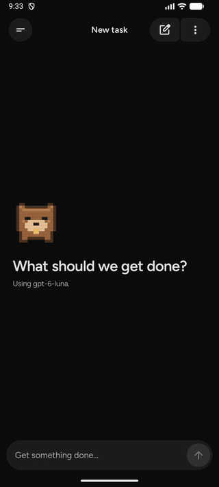
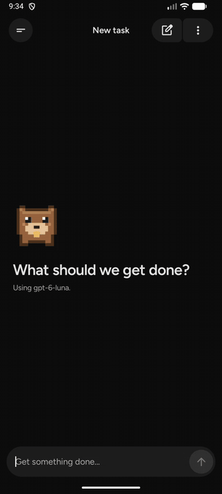
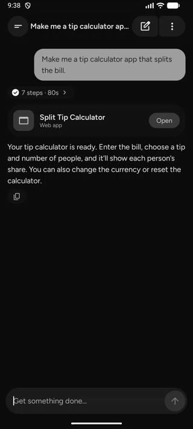
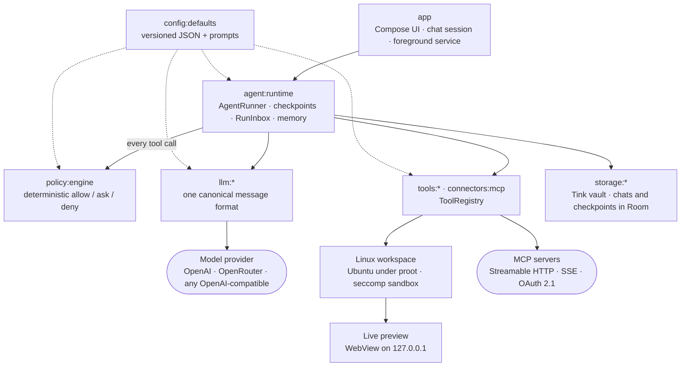

<p align="center"></p>

<h1 align="center">Whittle</h1>

<p align="center">An AI agent harness that runs entirely on an Android phone. Any model, your own keys, no backend.</p>

<p align="center"><a href="https://github.com/Arunprakaash/Whittle/releases/latest">Download the latest APK</a></p>

Whittle runs the whole agent loop on the phone: the model calls, the policy checks, the tools and the
checkpoints. It searches the web, runs commands in a sandboxed Ubuntu on the phone, builds web apps with Vite and
serves them to a live preview, and talks to any MCP server. There is no Whittle server.
The phone talks straight to the model provider you pick, using your own key.

<table>
  <tr>
    <td align="center"><br>Research with sources</td>
    <td align="center"><br>Builds an app (4× speed)</td>
    <td align="center"><br>…that you use right away</td>
  </tr>
</table>

## Architecture



### The agent loop

`AgentRunner` calls the model, checks every proposed tool call against the policy engine, runs what's allowed
and repeats. It is plain Kotlin with no Android dependency, so the same loop runs in the app and in the
terminal (`dev:cli`).

- **Checkpoints.** A checkpoint is saved after every step and before every tool call. `resume` continues after
  process death, or after the user answers, without repeating a side effect.
- **Interrupts.** A call that needs approval, or access to something on the phone, pauses the run with
  `AWAITING_USER` once the step's other calls are done. The answer replaces the placeholder result in place,
  so the model sees what actually happened, the way Deep Agents resumes an interrupt. Questions (`ask_user`)
  don't pause.
- **Steering.** Messages the user sends mid-run, and their answers to cards, arrive through `RunInbox` and are
  applied at the next step boundary.
- **Long tasks.** Provider failures are retried with backoff, but only while nothing has been shown to the
  user. Tool output past a size limit is saved to the workspace (`.whittle/outputs`) for the model to read
  in sections, instead of filling the context.
- **Memory.** `MemoryStore` owns the limits, ids and the `remember` / `forget` tools, and fills
  `{{memories}}` in the system prompt. The host only supplies storage: an encrypted file on the phone, a
  JSON file in the CLI.

### Policy is code, not the model

`RuleBasedPolicyEngine` decides every tool call in a fixed order where deny always wins:

1. hard denylist
2. deny rules
3. model trust tier denials
4. tainted run plus an outbound tool, or tainted run plus personal data plus a web read
5. unattended runs (pre-approved tools only)
6. trust tier approval threshold
7. ask rules
8. allow rules
9. the tool's risk-tier default

Rules live in `policy-rules.json`, and model trust tiers in `model-trust.json`. Content carries provenance:
anything from the web, a file or a tool result marks the run as tainted. From then on, sending data out needs
the user's approval, so a web page can't instruct the agent to exfiltrate anything. Models without a trust
rating can't use high-risk tools at all.

### One message format, any model

`core:model` defines provider-neutral messages, tool calls and token usage. Adapters translate at the edge:
`llm:adapter-openai-compatible` streams Chat Completions (OpenRouter, Groq, Together, Ollama…), and
`llm:adapter-openai-responses` speaks the OpenAI Responses API with reasoning, hosted web search and
`store: false`. Providers and models come from `provider-catalog.json` and `model-defaults.json`, not code.

### Linux on the phone

Commands run in a real Ubuntu (24.04) that Whittle downloads during onboarding, so `apt`, compilers and
prebuilt Linux programs work as on a computer. It's an ordinary folder in the app's storage, started with
[proot](https://github.com/termux/proot), which gives programs their own root folder without root access.
`docs/linux-workspace.md` has the design.

- **Setup.** `LinuxWorkspace` downloads the image (resumable, pinned by SHA-256 in `linux-workspace.json`),
  unpacks it with `tar` under `proot --link2symlink`, writes the configured files and installs the base packages.
  It runs under its own foreground notification, and Settings can repair, reset or remove it.
- **Running programs.** Android only lets an app execute programs from its APK's native-library folder, unless
  it targets SDK 28 or lower. Whittle targets 28, so programs inside Linux may run, and ships on GitHub rather
  than Play. proot and tar themselves are pinned Termux packages that `TermuxRuntimeTask` packs as native
  libraries, with the Termux prefix rewritten to the app's own (padded to the same length, so the binaries stay
  intact).
- **One workspace for every chat.** A single folder lives outside Linux and is mounted at `/workspace`; a chat
  can start several projects in it and any other chat can carry on with them. Deleting a chat keeps its files.
  The file tools read and write Linux paths directly, following links the way Linux would without ever leaving
  the workspace (`LinuxFileSystem`), and record what each chat changed for the file browser (`FileChangeLog`).

Every command starts through `whittle_sandbox`, a small C program built with the NDK
(`app/src/main/native/sandbox`), linked statically and mounted into Linux. It puts the command behind a seccomp
filter, which the command and everything it starts keep for life:

- No `ptrace`, `process_vm_readv` or `process_vm_writev`, so it can't read the app's memory, where keys are
  decrypted while in use.
- No `io_uring`.
- No sockets of any kind unless the step was allowed the network. That includes DNS and loopback.

If the filter can't be installed, the command doesn't run. proot itself is a filesystem view, not a security
boundary; the filter, Android's app sandbox and the policy engine are.

### Apps are servers

Whittle builds apps the way a developer does: a Vite project in its own folder in the workspace, run with `start_process`.
`ProcessManager` keeps it running after the tool call returns, in Linux behind the same sandbox, and watches its
port. Once something answers, the chat shows a card with Preview, which opens the page from `127.0.0.1` in a
WebView, with its console one tap away and Ask to fix sending errors back to the agent. The agent reads output
with `read_process_output`, and `list_processes` / `stop_process` manage what runs. Processes end when stopped
or with the app; the card restarts one with the same command. With Keep working in the background on, a
notification lists them and keeps them running, with Stop all.

### Connectors

`connectors:mcp` speaks MCP over Streamable HTTP and the older SSE transport. Sign-in uses OAuth 2.1:

- server discovery, dynamic client registration, PKCE and state;
- a loopback redirect (`http://127.0.0.1:<port>/oauth/<id>`, RFC 8252) that the phone listens on while a
  sign-in is open. Many servers reject custom-scheme redirects, but they accept this one.

Tokens are kept in the vault and never pass through the chat.

### Storage, telemetry, design

- **Storage.** Keys and tokens are in a Tink vault keyed by the Android Keystore. Chats and run checkpoints
  are in Room, with their content encrypted through `ContentCipher`. Each chat's workspace is exposed to Android's Files app through a
  `DocumentsProvider`.
- **Telemetry.** `observability:api` is vendor-neutral with consent filtering, and `observability:posthog`
  adapts it. Events carry metadata only. Session replays mask messages, answers, chat titles and apps.
- **Design system.** W3C DTCG tokens in `docs/design/tokens` generate the Compose colors, type, spacing and
  Material 3 Expressive motion springs. A sprite file generates the beaver's animation and every launcher
  and notification icon.

### Configuration

Nothing that may change lives in code. The defaults are in
`config/defaults/src/main/resources/whittle/config`:

| File | What it holds |
|---|---|
| `harness-config.json` | Run limits, retries, tool output and memory limits |
| `provider-catalog.json`, `model-defaults.json`, `model-trust.json` | Providers, models and their trust tiers |
| `policy-rules.json` | Policy rules |
| `tool-presentation.json` | How each tool's steps and cards are labelled |
| `connectors.json`, `app-defaults.json` | Connectors and app settings |
| `terminal.json`, `linux-workspace.json` | Command and process limits, and the Linux image and its setup |
| `agent-messages.json`, `prompts/agent-system.md` | Everything the model is told |

Every file has a `schemaVersion`, and unknown keys are rejected.

### Modules

| Module | What it does |
|---|---|
| `core:common` | `Outcome`, typed `HarnessError`, `Secret`, PKCE, clock and id abstractions, `ContentCipher` |
| `core:model` | Canonical, provider-neutral messages, tool calls, provenance, token usage |
| `core:config` | `ConfigLoader` (versioned, strict JSON), `HarnessConfig`, prompt templates |
| `config:defaults` | The default config shipped with the app |
| `llm:api` | `ModelAdapter`, provider and model catalogs, trust tiers, stream events |
| `llm:http` | Shared streaming plumbing: Server-Sent Events, provider URLs and auth headers |
| `llm:adapter-openai-compatible` | Streaming Chat Completions adapter and model lister |
| `llm:adapter-openai-responses` | OpenAI Responses API adapter |
| `llm:openrouter-auth` | One-tap OpenRouter sign-in with OAuth PKCE |
| `tools:api` | `ToolDefinition`, `ToolRegistry`, risk tiers, argument validation |
| `tools:presentation` | Step labels and approval cards for each tool |
| `tools:device`, `tools:android` | Clock, contacts, calendar, message drafts |
| `tools:web` | Web fetch over https; output is untrusted |
| `tools:workspace` | Files, the sandboxed shell (`run_command`), long-running processes and Linux paths |
| `connectors:mcp` | MCP client with OAuth 2.1, tokens or no sign-in |
| `policy:engine` | The deterministic policy engine |
| `agent:runtime` | `AgentRunner`, checkpoints, plans, approvals, memory, saved outputs |
| `observability:api`, `observability:posthog` | Telemetry with consent filtering, and its PostHog adapter |
| `storage:secrets`, `storage:runs`, `storage:chats` | Encrypted vault, run checkpoints and chats |
| `design:system` | Compose design system generated from the tokens and the beaver sprite |
| `app` | The Android app |
| `dev:cli` | Runs the real agent loop from a terminal with your own key |

The design-time diagrams are in [docs/architecture](docs/architecture/README.md), with their Excalidraw
sources. They were drawn before the code, so where they differ, the code is right.

## Build

### Requirements

- JDK 17 or later. Android Studio's bundled JDK works.
- Android SDK with platform 37 and NDK `28.2.13676358`, which builds the sandbox.
- Network access on the first build, which downloads the pinned Termux packages for proot and tar (see
  `app/termux-runtimes.lock.json`). They're cached in `~/.gradle/caches/whittle-termux` after that.
- A 64-bit ARM device or emulator (`arm64-v8a`), Android 8 or later.

### Compile, test and install

```bash
export JAVA_HOME="/Applications/Android Studio.app/Contents/jbr/Contents/Home"
```

Run the unit tests:

```bash
./gradlew test
```

Build a debug APK, which installs next to a release build as `app.whittle.debug`:

```bash
./gradlew :app:assembleDebug
```

Build the release APK (minified, and signed if signing is set up):

```bash
./gradlew :app:assembleRelease
```

Install it on a connected device:

```bash
adb install -r app/build/outputs/apk/release/app-release.apk
```

To update the pinned Termux packages, edit `app/termux-runtimes.json` and refresh the lock file:

```bash
./gradlew :app:updateTermuxLock
```

### Optional properties

Keep these in `~/.gradle/gradle.properties`, never in the repo:

| Property | Effect |
|---|---|
| `whittle.posthogProjectKey` | Turns analytics on. Without it, nothing is sent. |
| `whittle.replayShowContent=true` | Your own test builds show content in session replays. Never set it for builds you ship. |
| `whittle.posthogDebug=true` | Verbose PostHog logging. |
| `whittle.releaseSigningFile` | Path to the signing properties (`storeFile`, `storePassword`, `keyAlias`, `keyPassword`). Defaults to `~/.whittle/release-signing.properties`. Without it the release APK is unsigned. |

## Run the agent from a terminal

`dev:cli` runs the same `AgentRunner`, policy engine and tools against your own key. Store the key in a local
file outside the repo:

```bash
dev/cli/save-dev-key.sh openai
```

Build the CLI:

```bash
./gradlew :dev:cli:installDist
```

List the models your key can use:

```bash
dev/cli/build/install/cli/bin/cli --provider openai --list-models
```

Run a task:

```bash
dev/cli/build/install/cli/bin/cli --provider openai --model <model-id> --prompt "What time is it in Tokyo?"
```

Pick the reasoning effort with `--reasoning none|low|medium|high`; the default comes from `model-defaults.json`.
Use `--approve ask|always|never` to choose how approvals are handled (the default `ask` prompts in the
terminal), and `--memory-file` to choose where memories are kept (default `~/.whittle/cli-memory.json`).
